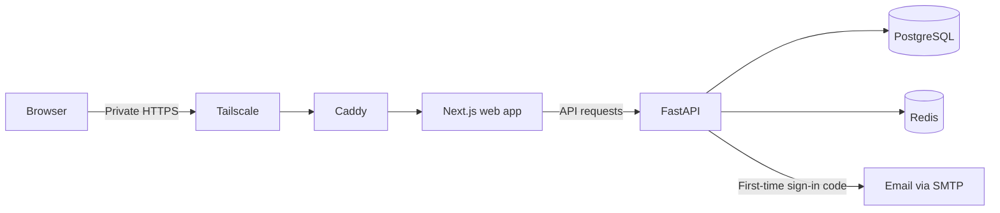
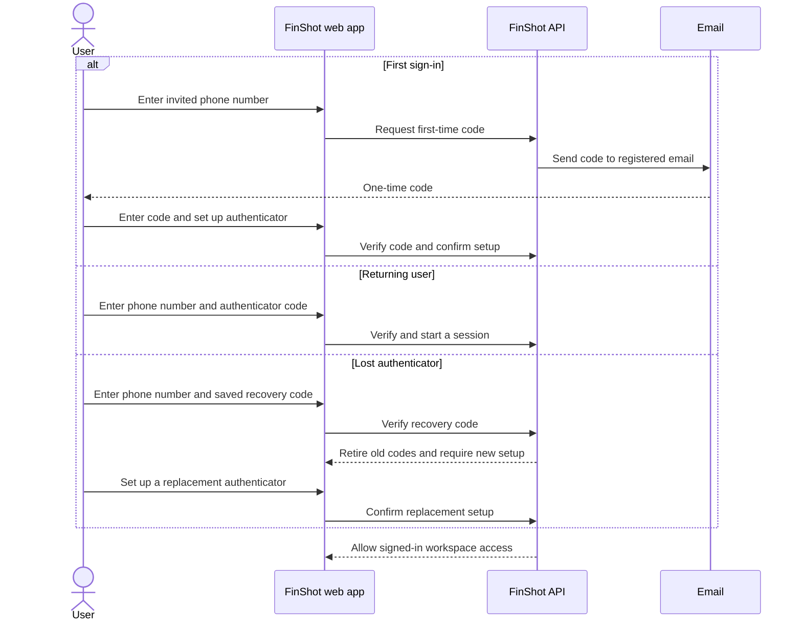
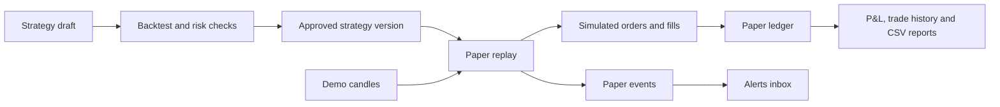
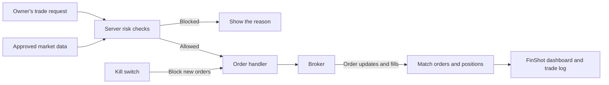
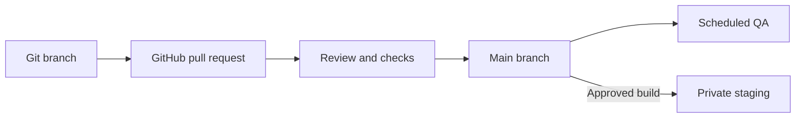

<h1 align="center"><em>FinShot</em></h1>

<p align="center">A personal trading workspace for Indian markets.</p>

## Why I started FinShot

I wanted one place to check Indian markets, keep a watchlist, test a trading idea, and see what happened to each order. I also wanted to set limits before a trade and understand why an order was accepted or stopped.

FinShot started with screen designs and sample data. The first step was making the screens easy to use on a phone as well as a desktop. Next came invite-only sign-in, account recovery, and a server that could run practice trades and keep a record of them. The Dashboard, Markets, Reports, Alerts, and account settings use the backend on private staging. The remaining workspace integrations are tested against the API contract before deployment.

## Who it is for

FinShot is being built for my own trading workflow. The first live pilot is planned for my account only. Invited testers can use a private preview when access is arranged. The current staging build uses demo market data and simulated trades.

## Before you start

- **Private staging.** Have an invitation, access to the private Tailscale network, your invited phone number, and access to the registered email for first-time setup. Use an authenticator app for later sign-ins and keep your recovery codes somewhere private.
- **Local preview.** For approved development, install Node.js 22.12 or newer and npm. The preview comes with sample data.
- **Backend.** Have Python 3.12, PostgreSQL 16, and Redis 7. Docker Compose is used for staging. Keep passwords, email credentials, and any broker keys outside the repo. Follow the [backend setup](backend/README.md) and [staging handoff](backend/docs/STAGING_HANDOFF.md).
- **Planned live pilot.** The account owner will need an approved broker setup, permission to use the market feed, and risk controls that have passed testing.

```sh
cd frontend
npm ci
npm run dev
```

Open [the local preview](http://localhost:3000). The [frontend README](frontend/README.md) has the demo sign-in details and test commands.

## How the pieces connect

### Private staging

The browser talks to the web app over HTTPS. Next.js passes the API requests it supports to FastAPI. PostgreSQL holds account and paper-trading records. Redis helps limit sign-in attempts and holds short-lived state.



### Sign-in and recovery



### Paper trading on the server

A strategy version must pass its backtest and risk checks before it can be activated. The paper engine replays demo candles, records simulated fills, and keeps the ledger for reports.



### Planned live trading

This is the proposed route for the owner-only pilot. The current build has simulated fills. Live orders require a separate approval and checks against the broker.



### From a code change to staging



## Project folders

| Folder | What is inside |
| --- | --- |
| [frontend](frontend) | The Next.js app, charts, and browser tests |
| [backend](backend) | The FastAPI service, database changes, and tests |
| [contracts](contracts) | The [OpenAPI file](contracts/openapi.yaml) that describes the requests and responses |
| [qa](qa) | Independent checks and test reports |

## Trading risk

**You can lose money trading.** Leveraged trades can cost more than you put in. Prices can move before an order fills, and a stop-loss can fill at a worse price than expected. Results from backtests or practice trades cannot tell you what you will earn or lose in the market. Make your own trading decisions. You are responsible for any orders you choose to place.

## Ownership

FinShot is private property. See the [all-rights-reserved notice](LICENSE) and the [third-party notices](frontend/THIRD_PARTY_NOTICES.md).
