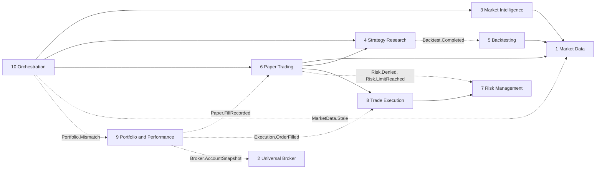

# Engine boundaries and event contracts

Jira: TRAD-5 (E01). Version **0.1.0 (draft)**. It becomes **1.0.0 (frozen)** only after
the architecture review recorded at the end of this file. Downstream engine tasks
(E02 to E19) must cite the version they build against.

Basis: workbook "Engine register" (ten engines, leads, task links) and the code on
main `e2c7b0e`. Statements about today's code are marked **Fact**. The boundary
rules, event envelope and event list are a **Proposal** until reviewed.

Scope reminder: modular monolith. Engines are Python packages under `backend/app/`
with one public interface each. They are not separate services. Demo, sandbox and
paper only. No live order path exists or is added here.

## 1. The ten engines

| # | Engine | Lead (workbook) | Package today (Fact) | State today (Fact) | Tasks |
|---|---|---|---|---|---|
| 1 | Market Data | Claude Data | `app/market` | Interface `MarketDataProvider` (`list_instruments`, `get_overview`, `get_candles`), a disabled provider and a demo provider. Every response is `source: demo`. | E02, E04, T34 to T37 |
| 2 | Universal Broker | Claude | `app/brokers` | Read-only `BrokerAdapter` (`authorize`, `fetch_account`) with a demo adapter for `zerodha` and `fyers`. No order methods. No MCP, no real connectivity. | T18 to T33 |
| 3 | Market Intelligence | Claude Quant | none | Not built. The Dashboard has only quotes from Market Data. | E03, E05, E12 to E15 |
| 4 | Strategy Research | Claude Quant | `app/strategies` | Strategies, versions, `risk_review`, `backtest_verdict`. No regime filter. | E06 |
| 5 | Backtesting | Claude Quant | `app/backtests` | Pure `replay(window, candles, position_size_bps)`, stored runs, a polling worker. | E07, T13 |
| 6 | Paper Trading | Claude | `app/paper` | Pure `step(...)` simulator, account, orders, trades, events, replays, a polling worker. | T14, T38 to T41, E17 |
| 7 | Risk Management | Claude Risk | not a package | Partial and embedded: `paper/engine.py` (`risk_blocked`, `session_loss`) and `strategies/rules.py` (`risk_review`). | E08 |
| 8 | Trade Execution | Claude Risk | not a package | Simulated fills live inside `paper/engine.py`. `BrokerAdapter` has no write methods. | E09, E21 |
| 9 | Portfolio and Performance | Claude + Codex | `app/reports` | Read-only paper reports and reconciliation over paper trades. UI is Codex's. | E10, E18 |
| 10 | Orchestration | Claude | `app/main.py`, `app/agents` | Three in-process polling workers (backtests, paper, agents). Four advisory agents. No market calendar, no shared event log. | E11, E17 |

Platform modules that are **not** engines and keep their owners: `auth`, `alerts`
(an inbox derived from engine events), `core`, `db`, `api`.

## 2. Boundary rules (Proposal)

1. An engine exposes one public module (`app/<engine>/api.py` once extracted). Other
   engines import only that module, never models, tables or private helpers.
2. An engine writes only its own tables. Cross-engine data moves by interface call
   (read) or by event (change).
3. Dependencies form a directed acyclic graph (section 3). An edge points from the
   consumer to the producer and counts both interface calls and event consumption.
   A cycle is a design defect and needs a review, not a workaround.
4. Risk Management is independent: it decides, others cannot override it. It
   answers `deny` when input is stale, missing or malformed (deny by default).
   Risk has no outgoing edges. It is a pure decision function: the caller passes
   the order intent, an exposure snapshot and a market snapshot, each stamped
   `asOf`. Risk denies when a snapshot is absent or older than its configured
   maximum age, so freshness stays enforced by Risk, not by the caller.
5. Trade Execution acts only on an approved Risk decision and only against a
   simulator sink. Adding a live write path needs gate G9 and a separate approval.
6. Every record that crosses an engine carries `userId`, `accountId` and an
   environment label (`DEMO` or `PAPER`). No cross-account reads.
7. Money is integer paise or `Decimal`. Time is UTC in storage, IST for market logic.

## 3. Dependency map (Proposal)

An arrow means "calls the public interface of" or "consumes events from".

Dotted lines are event consumption, solid lines are interface calls. A solid line
between two engines also covers any events the section 4 table lists between that
same pair (Orchestration to Paper Trading carries `Paper.EngineHalted` and
`Paper.ReplayFinished`; Paper Trading to Strategy Research carries
`Strategy.VersionCreated` and `Strategy.VersionValidated`). Those events add no new edge. Every other consumer
in the table appears as a dotted line, except Alerts (a platform module, not an
engine). Both kinds of line count as dependencies (rule 3). Nothing points back at an engine that reaches it, so the
graph is acyclic. Two choices keep it that way:

- **Backtesting does not call Strategy Research.** The caller (Orchestration, or
  the API) passes the strategy version's parameters in the backtest request as a
  plain value. Backtesting never imports Strategy Research. Strategy Research
  consumes `Backtest.Completed` to set its verdict.
- **Risk does not call Market Data or Portfolio.** Paper Trading builds the
  exposure snapshot from its own virtual account state and passes it, with a
  market snapshot, through Execution to Risk. Risk checks the `asOf` stamps (rule
  4). Portfolio only consumes fill, execution and broker events; nothing gates on it.

Consequence to review (section 5, question 6): when real broker positions exist,
the exposure snapshot used for gating must also include them, so the caller that
builds it needs a read path to Universal Broker.

## 4. Event contracts (Proposal)

**Fact:** there is no shared event log. Each engine keeps its own rows:
`paper_events` (message only), `agent_events` (coded), `broker_events`, and
`alerts` (11 kinds in `app/alerts/catalog.py`). Alerts are derived from those rows
in the source transaction or by the worker, deduplicated per source occurrence.

**Proposal:** one envelope, one outbox table per engine (written in the same
transaction as the change), read by Orchestration. No external broker, no new
service.

Envelope, version `1`:

| Field | Meaning |
|---|---|
| `eventId` | UUID, unique, the dedupe key |
| `type` | `<Engine>.<Name>`, for example `Paper.FillRecorded` |
| `version` | integer, part of the contract |
| `occurredAt` | UTC timestamp |
| `producer` | engine number or name |
| `userId`, `accountId` | tenant keys (accountId may be null for market events) |
| `environment` | `DEMO` or `PAPER` |
| `correlationId`, `causationId` | trace of the originating job or event |
| `payload` | typed per `type` and `version` |

Versioning: adding an optional payload field is a minor change inside the same
`version`. Removing or changing a field is a new `version`; producers emit both for
one release, consumers move, then the old one is dropped. Delivery is at least
once, so every consumer is idempotent on `eventId`.

Event list (names are the proposal; the "today" column is Fact):

| Producer | Event | Consumers | Today |
|---|---|---|---|
| Market Data | `MarketData.SnapshotPublished`, `MarketData.Stale` | Intelligence, Paper, Orchestration | none; overview is pulled |
| Universal Broker | `Broker.AccountSnapshot`, `Broker.ConnectionExpired`, `Broker.Disconnected` | Portfolio, Alerts | `broker_events` rows; alerts for the last two |
| Market Intelligence | `Intelligence.SnapshotPublished` | Orchestration, Dashboard API | not built |
| Strategy Research | `Strategy.VersionCreated`, `Strategy.VersionValidated` | Paper | rows in `strategy_versions` |
| Backtesting | `Backtest.Completed` | Strategy Research | `backtest_runs` status |
| Risk Management | `Risk.Approved`, `Risk.Denied`, `Risk.LimitReached`, `Risk.KillSwitchSet` | Execution, Paper, Alerts | alert kind `PAPER_RISK_LIMIT_REACHED` |
| Trade Execution | `Execution.OrderQueued`, `Execution.OrderFilled`, `Execution.OrderCancelled` | Paper, Portfolio, Alerts | alert kind `PAPER_ORDER_CANCELLED` |
| Paper Trading | `Paper.FillRecorded` | Portfolio, Alerts, Orchestration | `paper_events`; alert kind `PAPER_STOP_LOSS_EXIT` |
| Paper Trading | `Paper.EngineHalted`, `Paper.ReplayFinished` | Alerts, Orchestration | `paper_events`; alert kinds `PAPER_ENGINE_HALTED`, `PAPER_STRATEGY_INACTIVE`, `PAPER_REPLAY_FINISHED` |
| Portfolio | `Portfolio.Reconciled`, `Portfolio.Mismatch` | Alerts, Orchestration | alert kind `RECONCILIATION_MISMATCH` |
| Orchestration | `Job.Started`, `Job.Failed`, `Job.Retried` | Alerts | none |

Out of scope for E01: payload schemas. Each owning task (E02 to E11) defines its
payload when it implements the event, and lists it in `contracts/openapi.yaml`
only if an API exposes it.

## 5. Open questions for the review

These need an owner decision before downstream implementation.

1. **Ledger ownership.** The workbook gives "virtual execution and ledger" to Paper
   Trading and "canonical ledger and analytics" (E10) to Portfolio. Today the
   ledger tables (`paper_trades`) live in `app/paper`. Proposal: Paper owns virtual
   account state and emits fills; Portfolio owns the canonical ledger built from
   those fills; move the tables when E10 lands.
2. **Where Risk lives.** Proposal: extract a `risk` package at E08 and make Paper
   and Strategies call it. Until then the embedded checks stay and are the
   reference behavior for E08's tests.
3. **Event transport.** Proposal: Postgres outbox plus the existing polling
   workers. The alternative is Redis streams. Redis is already deployed but is
   treated as a cache and rate-limit store today.
4. **Agents.** The four advisory agents (`market-scanner`, `strategy-analyst`,
   `risk-explainer`, `execution-monitor`) are not in the engine register.
   Proposal: they are read-only observers of engine events, owned by
   Orchestration, and can never change an outcome.
5. **Frontend consumers.** Codex owns the screens; each engine's API stays in
   `contracts/openapi.yaml`, changed only by a separate contract PR.
6. **Exposure for gating.** Today only paper state exists, so Paper Trading can
   supply the exposure snapshot. With real broker data (gate G3 and later) the
   snapshot must include broker positions. Decide then between two options, both
   acyclic: (a) Execution reads Universal Broker directly (adds Execution to
   Universal Broker), or (b) Orchestration, or another caller above Execution,
   builds the snapshot from Paper Trading and Universal Broker and passes it in.
   Portfolio is **not** an option: it consumes Paper and Execution events, so
   Execution reading Portfolio would create Execution to Portfolio to Execution
   (and to Paper and back). Making it work would mean Portfolio stops consuming
   those events, which removes its purpose.

## 6. Review record

| Item | Status |
|---|---|
| Boundary map and dependency map | Draft 0.1.0 |
| Architecture review before implementation | **Pending**: CodeRabbit on the PR, then owner decision on section 5 |
| Frozen as 1.0.0 | Not yet |
| Tested revision | Docs only; read against main `e2c7b0e` |
